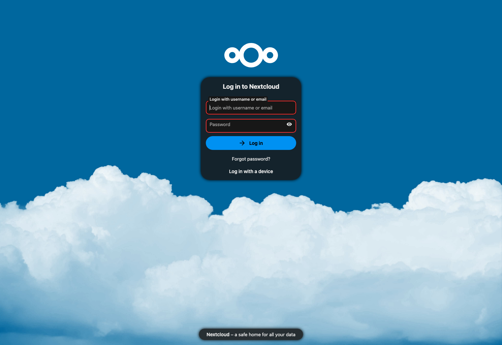
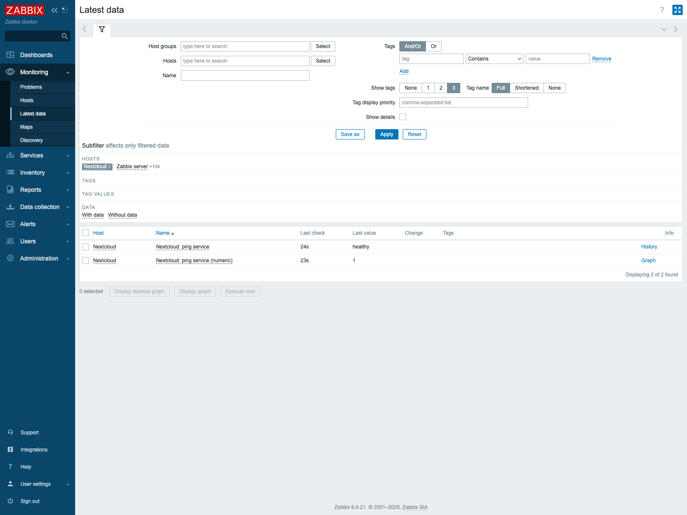
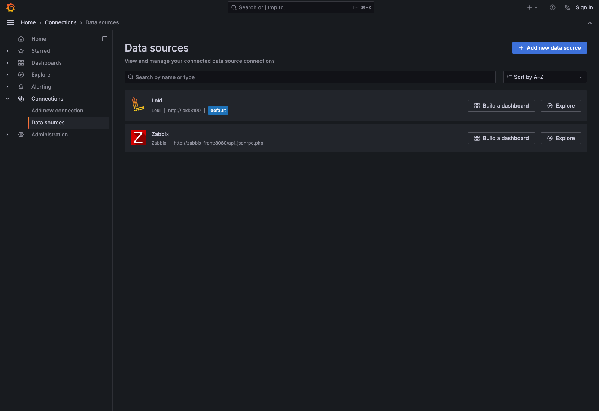
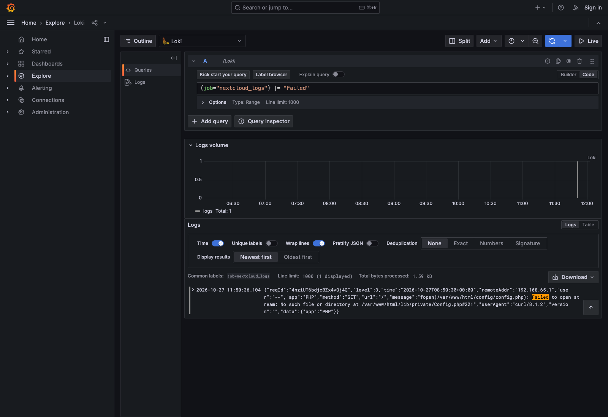
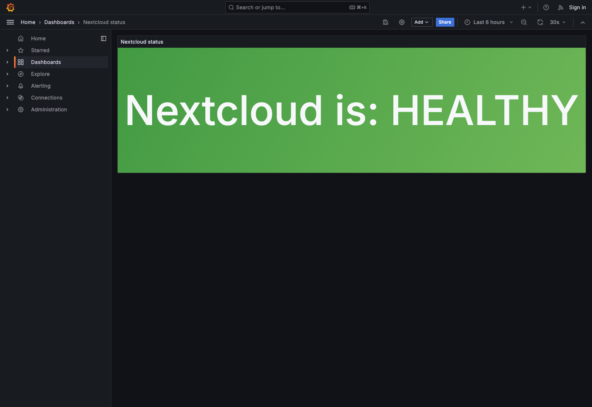
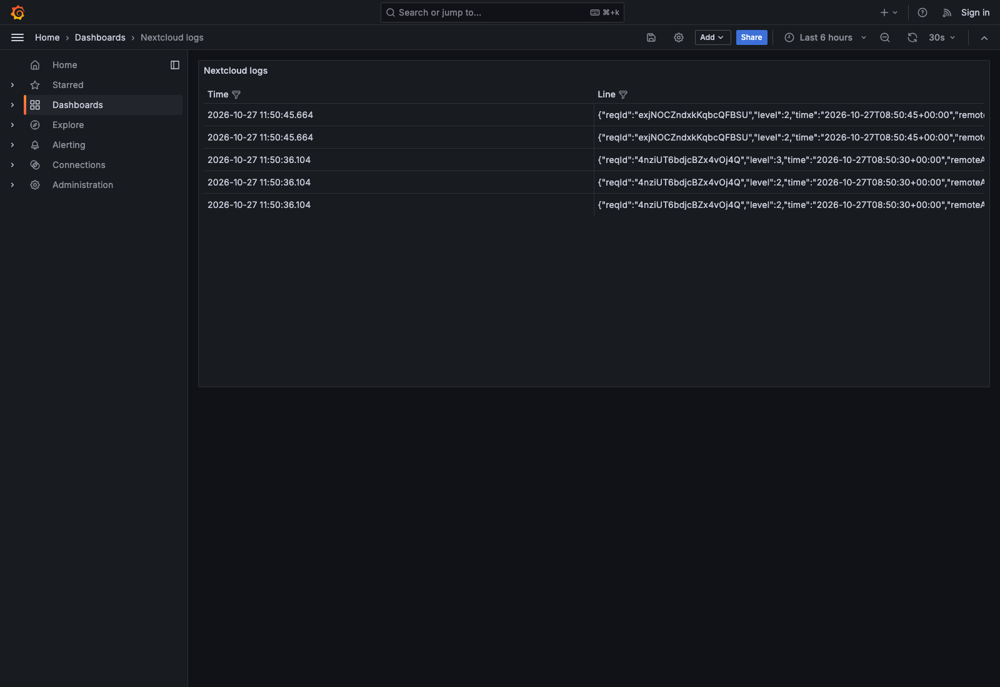

# ЛР 1. Loki + Zabbix + Grafana

Стек поднимался командой `docker compose up -d`. Все семь контейнеров в состоянии Running.


Учётные записи, которые создавались по ходу работы:


| Сервис    | Логин | Пароль         | Адрес                                          |
| --------- | ----- | -------------- | ---------------------------------------------- |
| Nextcloud | admin | Lab-admin-2026 | [http://localhost:8080](http://localhost:8080) |
| Zabbix    | Admin | zabbix         | [http://localhost:8082](http://localhost:8082) |
| Grafana   | admin | admin          | [http://localhost:3000](http://localhost:3000) |


В Grafana также включён анонимный доступ с ролью Admin, как в compose-файле.

## Часть 1. Логирование

После старта все сервисы в состоянии Up, Postgres и веб Zabbix — healthy:


Nextcloud установлен через веб-форму: учётка `admin`, база SQLite, каталог данных `/var/www/html/data`. После установки открывается страница входа.



Лог пишется внутрь контейнера `nextcloud`, в файл `/var/www/html/data/nextcloud.log`. Это каталог data-тома. Проверка из терминала: файл на месте, в конце видны строки журнала.


Тот же data-том смонтирован в Promtail как `/opt/nc_data`, поэтому сборщик читает этот файл у себя локально. В логе Promtail есть строка `Seeked /opt/nc_data/nextcloud.log`: файл найден и чтение начато с начала. Loki уже принял эти строки и отдаёт по ним метки `job=nextcloud_logs` и `filename=/opt/nc_data/nextcloud.log`.


## Часть 2. Мониторинг

Шаблон из `template.yml` импортирован в Data collection → Templates (группа Templates/Applications, шаблон Test ping template).

Чтобы Zabbix ходил в Nextcloud по короткому имени контейнера, это имя добавлено в доверенные домены. Команда отработала: `trusted_domains` под номером 1 равен `nextcloud`.


Хост создан так: техническое имя `nextcloud` (его подставляет макрос `{HOST.HOST}` в URL `http://{HOST.HOST}/status.php`), видимое имя Nextcloud, группа Applications, шаблон Test ping template.

В Latest data у элемента **Nextcloud: ping service** значение `healthy`.



Плагин Zabbix для Grafana 11.2 умеет строить график только по числовым item. Текстовое значение `healthy` само по себе на плашку не попадает, поэтому на том же хосте добавлен вычисляемый item `nextcloud.ping.ok`:

```text
find(/nextcloud/nextcloud.ping,,"eq","healthy")
```

Он равен 1, пока шаблонный item равен `healthy`, и 0 в остальных случаях. На скриншоте это вторая строка со значением 1.

## Часть 3. Визуализация

Плагин поставлен командой из методички, затем Grafana перезапущена. В выводе видно, что стоит alexanderzobnin-zabbix-app 6.10.0, контейнер `grafana` после рестарта поднялся.


Плагин включён.

Источники данных:

- Loki, адрес `http://loki:3100`. Save & test: Data source successfully connected.
- Zabbix, адрес `http://zabbix-front:8080/api_jsonrpc.php`, пользователь Admin, пароль zabbix. Save & test: Zabbix API version 6.4.21.



## Задание


### Запросы

В Explore выбран источник Loki. В фильтре лейбла из выпадающего списка взят селектор `job` и значение `nextcloud_logs` — оно подставилось само, его не пришлось вписывать вручную. После Run query внизу видна строка лога.


Дальше тот же поток проверен более узкими запросами.

Только строки с ошибкой открытия файла. Нашлась запись PHP про `fopen(.../config.php): Failed to open stream`.

```logql
{job="nextcloud_logs"} |= "Failed"
```



Число строк за последние 6 часов:

```logql
count_over_time({job="nextcloud_logs"}[6h])
```

Результат: 5.

Разбор JSON и короткий вывод уровня и сообщения:

```logql
{job="nextcloud_logs"} | json | line_format "{{.level}} {{.message}}"
```

Примеры строк: `2 Host localhost was not connected to because it violates local access rules` и `3 fopen(/var/www/html/config/config.php): Failed to open stream...`.

По Zabbix в Latest data видны оба значения: текст `healthy` и число `1`.

### Дашборды

Два дашборда.

1. **Nextcloud status** — datasource Zabbix, панель Stat с зелёной плашкой. Значение 1 отображается как `Nextcloud is: HEALTHY`, 0 — как `Nextcloud is: UNHEALTHY` на красном фоне.



1. **Nextcloud logs** — datasource Loki, таблица по запросу `{job="nextcloud_logs"}`. Колонки Time и Line.



Адреса: [http://localhost:3000/d/nc-zabbix/nextcloud-status](http://localhost:3000/d/nc-zabbix/nextcloud-status) и [http://localhost:3000/d/nc-logs/nextcloud-logs](http://localhost:3000/d/nc-logs/nextcloud-logs).

## Ответы на вопросы

**Чем SLO отличается от SLA?**

SLA (Service Level Agreement) — договор между поставщиком и заказчиком: какой уровень сервиса обещан и что будет при нарушении (штраф, компенсация, кредит). SLO (Service Level Objective) — конкретная измеримая цель внутри этого сервиса, например доступность 99,9% за месяц. SLO — это цель, по которой смотрят, выполняется ли обещание. В одном SLA обычно несколько SLO.

**Чем отличается инкрементальный бэкап от дифференциального?**

Инкрементальный копирует только то, что изменилось с прошлого бэкапа любого типа: с полного или с предыдущего инкрементального. Чтобы восстановиться, нужны полный бэкап и вся цепочка инкрементов по порядку. Дифференциальный копирует всё, что изменилось с последнего полного бэкапа. Для восстановления нужны полный бэкап и один, последний, дифференциальный. Дифференциальный обычно больше по объёму, зато цепочка короче.

**В чём разница между мониторингом и observability?**

Мониторинг следит за заранее выбранными показателями и порогами и сообщает, что порог нарушен. Observability — это возможность по внешним сигналам (метрики, логи, трейсы) понять, что происходит внутри системы, в том числе в сбое, который заранее не описали отдельной проверкой. Мониторинг отвечает на вопрос «что вышло за границу», observability помогает выяснить, почему.